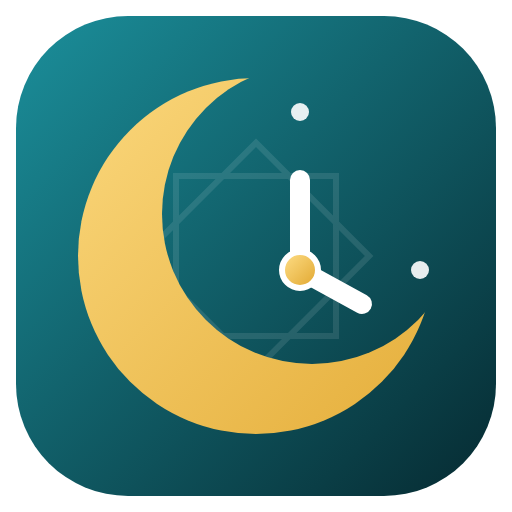

# SA3A · ساعة

A Windows desktop app that combines **Islamic prayer times** with a full **clock app**: alarms, timers, stopwatch and world clock. It is available in **English, العربية and Türkçe**.



## Download

Get **`SA3A-Setup-<version>.exe`** from the [Releases page](../../releases) and run it.

- **Windows warning:** the installer isn't code-signed yet, so Windows may say *"Windows protected your PC"*. Click **More info → Run anyway**.
- **What it installs:** Start-menu and desktop shortcuts, and an entry in *Settings → Apps → Installed apps*.
- **Uninstalling:** use *Installed apps* or *Start menu → SA3A → Uninstall*. Your settings are kept in `%APPDATA%\SA3A` in case you reinstall.

## Features

| Area | What it does |
|---|---|
| **Prayer times** | Calculated for your **exact coordinates**, down to the second, so each district of a city gets its own times. Works offline once the location is set. A countdown shows the time to the next prayer, and Friday shows *Jumu'ah*. In Ramadan it adds an Iftar countdown and the Suhoor end time. |
| **Methods** | Picked automatically per country, e.g. **Diyanet** for Türkiye, **Umm al-Qura** for Saudi Arabia, Egyptian, Karachi, Dubai, Qatar, Kuwait, Singapore, Tehran, ISNA, MWL and Moonsighting. You can also choose one yourself, set Hanafi or Standard Asr, choose a high-latitude rule, and adjust each prayer by ± minutes. |
| **Azan** | Each prayer has three modes: **azan**, **notification only** or **off**. Voices: Makkah (Sheikh Ali Ahmed Mulla), a Makkah Fajr azan, Madinah, Turkish (Anuar Duman) and Mishary Alafasy. Each comes as a **short version** (opening *Allahu Akbar* only, for people who already hear a nearby mosque) or the full azan. You can also use your own audio file or a YouTube link, and set a reminder before each prayer. |
| **Islamic calendar** | A month view with Hijri dates (Umm al-Qura), upcoming Ramadan, Eid al-Fitr, Eid al-Adha, Arafah, Islamic New Year, Ashura, Mawlid, Isra & Mi'raj, Mid-Sha'ban and Laylat al-Qadr, and a ±2-day Hijri adjustment for countries that start the month by local moon sighting. |
| **Qibla** | A **satellite map** with your home pin and a gold arrow pointing to the Kaaba. Line yourself up with a wall or street you can see on the picture. Also shows the angle from true north, the true great-circle route and the distance. Click or drag the pin to set your exact location. |
| **Alarms** | Any time, repeat days or a specific date (e.g. 100 days from now), and snooze. The sound can be the chime, an azan, an audio file from your PC, or a **YouTube link**. If YouTube can't play, the built-in sound plays so the alarm is never silent. |
| **Timers** | No upper limit: 100 days or more. Several timers can run at once, and they keep counting through restarts and shutdowns. |
| **Stopwatch** | Laps, with the best and worst lap highlighted. No upper limit, and it keeps running after the app restarts. |
| **World clock** | Analog and digital clocks for any time zone, with the difference from local time. |
| **Settings** | Language, dark/light/system theme, six accent colours, a **smooth animations** switch, 12/24-hour time, start with Windows, start in the tray, and keep running when closed. |

### Accuracy of prayer times

The Diyanet method is checked against Diyanet's official Beylikdüzü timetable and agrees within 1 minute (see `test/core.test.js`). SA3A rounds up to the minute, the way Diyanet publishes its times.

Ramadan and Eid dates follow the Umm al-Qura calendar. Countries that start the month by **local moon sighting** can differ by one day, which is what the Hijri adjustment setting is for.

### Things to know

- **When alarms ring:** alarms and azan ring while the PC is on and SA3A is running, including when it is minimised to the tray. An alarm that falls while the PC is asleep rings on wake-up if it is under 10 minutes late; otherwise SA3A shows a "missed" notification. A PC that is shut down cannot ring, which is the same as Microsoft's Clock app.
- **What needs internet:** the satellite picture, place search and YouTube sounds. Prayer times, azan, the Qibla angle, alarms and timers all work offline.

## Development

```bash
npm install
```
```bash
npm start
```
```bash
npm test
```
```bash
npm run dist
```

`npm start` runs the app, `npm test` runs the prayer-time, Hijri and Qibla tests, and `npm run dist` builds `dist/SA3A-Setup-<version>.exe` (on Linux this needs Wine). Every push builds the installer on a Windows machine in GitHub Actions. The build also installs, launches and uninstalls the app there. Running the workflow manually, or pushing a `v*` tag, publishes a Release.

```
main.js            Electron main process: window, tray, storage, notifications, start with Windows
preload.js         The small, safe bridge between the UI and Windows
src/index.html     UI entry
src/styles.css     Design system (themes, accents, motion)
src/js/prayer.js   Prayer times, Hijri calendar, Islamic events
src/js/qibla.js    Qibla bearing, distance, great-circle path
src/js/scheduler.js  One heartbeat for alarms, timers and azan, including events missed during sleep
src/js/views/      Screens
build/             Icon and installer script
scripts/           vendor.js (copies libraries and icons), icons.js (renders the app icon)
```

## Credits

- **Prayer calculation:** [adhan-js](https://github.com/batoulapps/adhan-js) (MIT).
- **Map:** [Leaflet](https://leafletjs.com) (BSD-2). Imagery © Esri, Maxar, Earthstar Geographics. Place search © OpenStreetMap contributors (Nominatim).
- **Icons:** [Lucide](https://lucide.dev) (ISC).
- **Azan recordings:** taken from the public [Kiwifu/adhan-mp3](https://github.com/Kiwifu/adhan-mp3) collection, which has no stated licence. See `src/assets/azan/CREDITS.md`.
