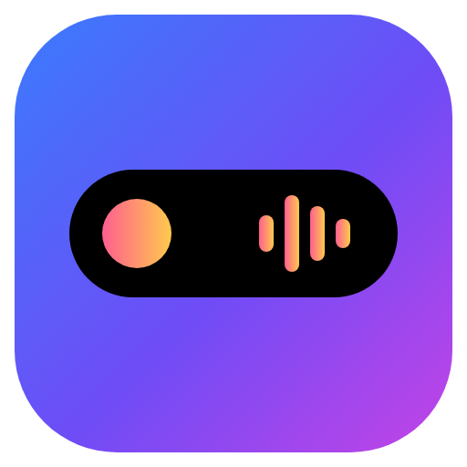

# WinIsland

A **Dynamic Island for Windows 10 and 11**. It replaces Windows notification pop-ups with an island at the top of your screen that morphs to show what's happening, the way the island on recent iPhones does.



## Download

Get **`WinIsland-Setup-<version>.exe`** from the [WinIsland release](../../releases/tag/winisland-v1.0.0) and run it. The installer isn't code-signed, so Windows may say *"Windows protected your PC"*: click **More info → Run anyway**.

## What it does

| | |
|---|---|
| **Notifications** | Every Windows notification appears in the island with the app's icon, name, title and message. **Hover** to read the whole message and get *Open* and *Dismiss* buttons. **Click** to open the app. Several messages from one app are grouped, and the expanded island keeps a history. You can mute apps, use Do not disturb, or hide message text until you hover (privacy mode). |
| **Now playing** | Spotify, YouTube and YouTube Music in Chrome, Edge, Firefox, Brave or Opera, Media Player (mp3/mp4), Movies & TV, VLC 4, Apple Music, Deezer, TIDAL and any other app that uses Windows media controls. Shows artwork, title, artist and a live waveform tinted with the artwork's colours. You can **play/pause, skip forward and back, drag the progress bar to move through the video or song** (or scroll over it for ±5 s), toggle shuffle and repeat, switch between players, and jump to the app. |
| **Live activities** | Timers and a stopwatch with laps that count down in the island. Two at once split into the island plus a small bubble, like on iPhone. |
| **System** | Charging animation and low-battery warning. A volume pop-up you can drag or scroll. Headphones / Bluetooth / speaker switches. Green and orange camera and microphone dots that name the app using them. A Do not disturb indicator. |
| **Settings app** | Theme (black, graphite, glass, light), accent colour, album-art glow, waveform and animation style. **Size** from 70% to 160%. **Position**: top or bottom, left, centre or right, on any monitor or following the mouse, with fine offsets. Hover or click to expand, delays, banner time, fullscreen hiding, start with Windows, and per-feature switches. |

### Hiding Windows' own pop-ups

WinIsland reads notifications that Windows has already received, so Windows still shows its own banner too. To see each notification only once, turn on **Do not disturb** in Windows. You can also turn off **Show notification banners** for each app in *Settings → System → Notifications*. The *Get started* page in WinIsland has buttons for both. Notifications still reach the notification centre, which is where WinIsland reads them.

WinIsland first tries the official notification-listener permission. If Windows doesn't offer it to the app, WinIsland reads the notification history that Windows keeps for your account, in read-only mode.

## How it's built

```
main.js                 Electron main process: island window, settings window, tray, storage
preload.js              Safe bridge between the windows and the main process
src/island.*            The island: views, morphing animation, interactions
src/settings.*          The settings app
src/shared/             Settings schema, pure logic (media timeline, placement, app names), icons
lib/helper.js           Starts IslandHelper.exe and reads its JSON-lines output
lib/demo.js             Same protocol with sample data, for non-Windows machines and tests
native/IslandHelper/    C# (.NET Framework 4.8, ships with Windows) helper:
                          media sessions (GlobalSystemMediaTransportControls), notifications
                          (UserNotificationListener, or the notification history through winsqlite3),
                          volume and audio devices (Core Audio), camera/mic use, fullscreen, battery
```

## Development

```bash
npm install
```
```bash
npm run demo
```
```bash
npm test
```
```bash
xvfb-run -a node scripts/e2e.js
```

`npm run demo` runs the app with sample data on any OS, and `npm test` runs the unit tests. `scripts/e2e.js` drives the island and the settings window with Playwright and saves screenshots to `test/screenshots/`. To build the helper, run `npm run helper`, which needs the .NET SDK. To build the installer, run `npm run dist` on Windows.

Every push that changes `island/` runs `.github/workflows/winisland.yml`. On Linux it runs the unit and UI tests. On a real Windows machine it builds the helper and tests it against live Windows APIs: it plays a media session and pauses, resumes and seeks it, and it shows a toast and checks the helper reads it. It then builds the installer, installs it, launches it, uninstalls it, and publishes the setup file as the `winisland-v<version>` release.
